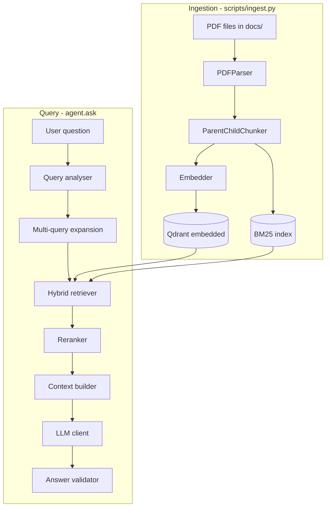

# Architecture

## Overview

The system is a version-aware documentation RAG agent. A single orchestrator (`DocumentationAgent`) wires ingestion, indexing, retrieval, reranking, and generation into one query pipeline.

## Entry points

| Entry point | Role |
|-------------|------|
| `scripts/ingest.py` | Index PDFs into Qdrant + BM25 |
| `scripts/chat.py` | Interactive terminal UI |
| `streamlit_app.py` | Web chat UI |
| `src/agent.py` | Programmatic API (`DocumentationAgent.ask()`) |

## Ingestion flow

1. **Scan** `docs/` for PDFs (config: `paths.docs_dir`)
2. **Diff detect** changed pages via `DiffDetector` (SHA-256 per page)
3. **Parse** with PyMuPDF + pdfplumber (text, headings, tables)
4. **Tag metadata** — version from filename/content, doc_id, section paths
5. **Chunk** parent (~1024 tokens) / child (~256 tokens); tables are atomic
6. **Embed** child chunks with Gemini (`RETRIEVAL_DOCUMENT` task type)
7. **Upsert** vectors into per-version Qdrant collections
8. **Update** BM25 index, parent store JSON, version registry

## Query flow

1. **Analyse query** — extract version intent, keywords (`query_analyser.py`)
2. **Multi-query** — optional LLM sub-query expansion (`multi_query.py`, disabled by default)
3. **Hybrid retrieve** — dense (Qdrant) + sparse (BM25), fused with RRF (`hybrid_retriever.py`)
4. **Small-to-big** — child hits upgraded to parent chunks for LLM context
5. **Rerank** — cross-encoder scores top candidates (`reranker.py`)
6. **Generate** — system + user prompt with cited context (`context_builder.py` + `llm_client.py`)
7. **Validate** — require citations, block hallucinations (`answer_validator.py`)

## Storage

| Store | Location | Purpose |
|-------|----------|---------|
| Qdrant (embedded) | `cache/qdrant_data/` | Dense vectors per version |
| BM25 | `cache/bm25/bm25_index.pkl` | Sparse keyword index |
| Parent store | `cache/parent_store.json` | Full parent chunks |
| Version registry | `cache/version_registry.json` | Indexed versions + latest |
| Page hashes | `cache/page_hashes.json` | Incremental ingest |

## Models (current config)

| Component | Provider | Model | Purpose |
|-----------|----------|-------|---------|
| Embeddings | Gemini API | `gemini-embedding-001` | Document and query vectors (768 dimensions) |
| LLM | Gemini API | `gemini-3.8-flash` | Answer generation |
| Reranker | Cohere API | `rerank-v3.5` | Candidate relevance ranking |
| Vector size | — | 768 dims | Must match embedding model |

## Configuration

- **File:** `config/config.yaml`
- **Env overrides:** `AGENT_<SECTION>__<KEY>=value`
- **API keys:** `GEMINI_API_KEY` and `COHERE_API_KEY` are loaded from `.env`

## Known setup requirements

- `docs/` is empty — no PDFs to query
- Gemini and Cohere API access is required for embedding, generation, and reranking
- Python packages from `requirements.txt` not installed
- No BM25 / version registry cache — run `scripts/ingest.py` after adding PDFs
